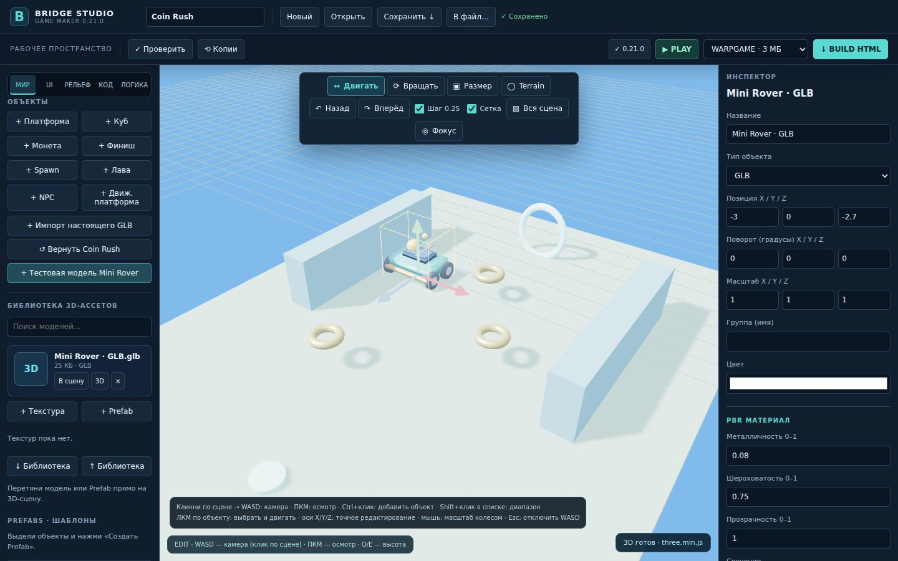

# Bridge Studio

**A lightweight local 3D editor for building HTML games with Three.js r128 / WebGL.**

> **Status: FROZEN — seeking community maintainers (November 4, 2026).**
>
> The original author has paused development. The source remains **public and open to forks, experiments and pull requests**. There is no guarantee of reviews, support, or future official releases.
>
> **© 2026 [jonhspoky2](https://github.com/jonhspoky2). [MIT License](LICENSE).**

**[Community handoff & architecture](COMMUNITY_HANDOFF.md)** · **[Contributing](CONTRIBUTING.md)** · **[Roadmap history](ROADMAP.md)** · **[Testing](TESTING.md)**

## What is Bridge Studio?

Bridge Studio is a Windows-oriented, local-first 3D game editor inspired by the ease of use of game-creation tools such as Roblox Studio. It uses **Three.js r128** and **WebGL** to create game scenes and export standalone HTML for the **WARPGAME** platform.

It is an **experimental editor, not a finished replacement for Roblox Studio or Unity**.



### Current capabilities

- **Build / Play** with a 3D viewport, camera movement, object selection and Move/Rotate/Scale tools.
- **Terrain** sculpting, painting, slope-aware player movement and basic 3D collision.
- **GLB / materials / prefabs** with basic model import, PBR material bank, asset previews and `.rwlib`.
- **Gameplay components and visual logic** for collectibles, doors, triggers, timers, checkpoints, counters and NPC interactions.
- **Quests and progression** with basic economy/inventory and optional local saved progress.
- **Graphics presets** for lighting, fog and atmosphere.
- **`.rwscene` projects** and **HTML game export**, including a WARPGAME profile.

**Most recent signed update at freeze:** `v0.22.2`. Later work such as [PR #28 — configurable soft shadows](https://github.com/jonhspoky2/bridge-studio-updates/pull/28) is a development candidate, **not** an installed official update.

## Build from source

Requirements: **Python 3** and a modern Chromium-based browser with WebGL. The standalone editor may need the Windows local host for some features, including signed update installation.

```sh
git clone https://github.com/jonhspoky2/bridge-studio-updates.git
cd bridge-studio-updates
python3 tools/build_studio.py --output studio.html
```

The result is a single editor HTML file. This build process does **not** create a Windows EXE installer and does **not** sign or install a patch. Do not upload the output to the official `updates/` channel without explicit authorization from the publisher.

Unit-test examples:

```sh
node tests/terrain-core.cjs
node tests/quest-v022.cjs
node tests/quest-collect-regression.cjs
```

For Chromium/Playwright dependencies and integration tests see [TESTING.md](TESTING.md) and [GitHub Actions](.github/workflows/terrain-source.yml).

### WARPGAME export budget

The **3,000,000-byte limit applies to the exported WARPGAME HTML game only**. The editor, `.rwscene` projects and local 3D assets are not limited to 3 MB. Asset optimization is necessary for detailed games.

## Important known limitations

- The custom GLB importer does **not fully support skinned meshes and glTF animation clips**: animated models currently appear as static geometry.
- No curated high-end original 3D asset library or finished animation/VFX pipeline.
- Windows installer and real GPU performance have not been comprehensively verified through automated CI.
- Some large modules need refactoring and old planning documents contain historical (not current) release information.
- The official signed update channel is maintained separately from community source builds.

See [COMMUNITY_HANDOFF.md](COMMUNITY_HANDOFF.md) for a fuller architecture map and priorities.

## Want to continue the project?

**Fork the repository and improve it**, or open an Issue/PR to collaborate. Particularly useful work: animated GLB/glTF support, quality original art assets, rendering polish, trustworthy Play/HTML parity, performance and Windows smoke testing.

The original maintainer does **not** promise to review or merge submissions; community forks may continue independently under the license.

## License, authorship and trademarks

Copyright **© 2026 jonhspoky2 — Bridge Studio**. Source code and associated project documentation are available under the **[MIT License](LICENSE)**. The copyright and permission notice must be preserved in copies or substantial portions. The license allows redistribution and commercial use; it does not guarantee exclusivity or prevent independent forks.

Third-party components/assets have their own licenses. Publisher signing keys and any third-party proprietary media are **not included** in the MIT grant. Roblox, WARPGAME and other brand names are referenced only for technical context and do not imply endorsement.

---

## Русский

**Bridge Studio — экспериментальный локальный 3D-редактор для создания HTML-игр WARPGAME. Проект заморожен 4 ноября 2026 года.**

Репозиторий открыт для сообщества: можно изучать код, создавать форки и предлагать улучшения. Главные направления — поддержка анимаций GLB, оригинальные качественные 3D-модели, графика, стабильность Play/HTML и тестирование на Windows.

**Авторские права: © 2026 jonhspoky2. Лицензия MIT** — разрешает изменять, использовать и распространять код при сохранении уведомления об авторских правах и текста лицензии. Официальные обновления не публикуются автоматически.

Для продолжения разработки: [инструкция для сообщества](COMMUNITY_HANDOFF.md) и [правила участия](CONTRIBUTING.md).
