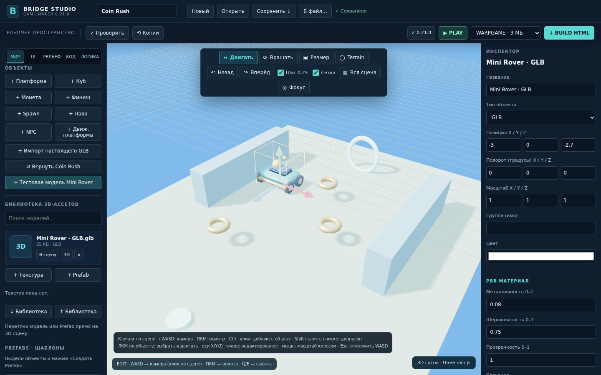
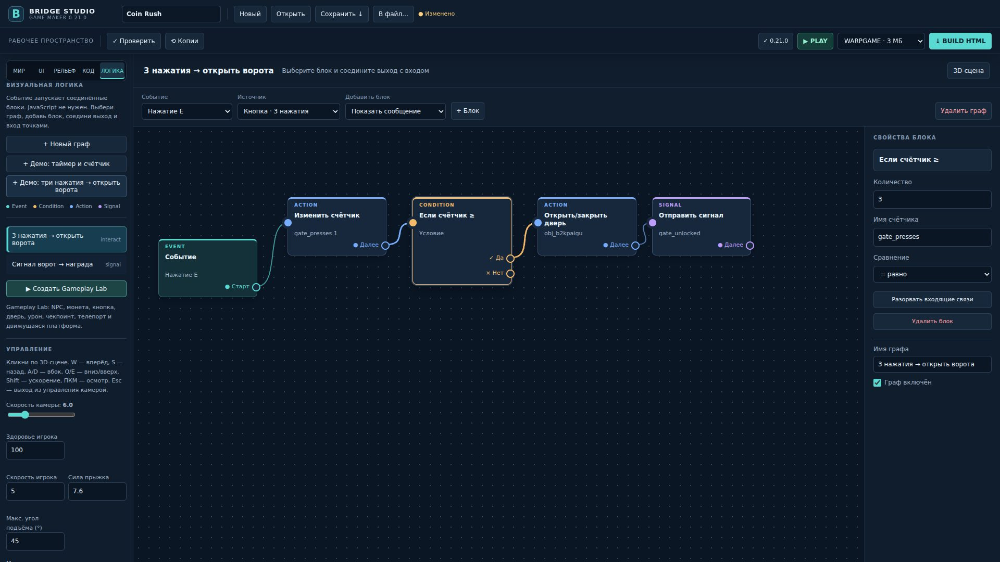
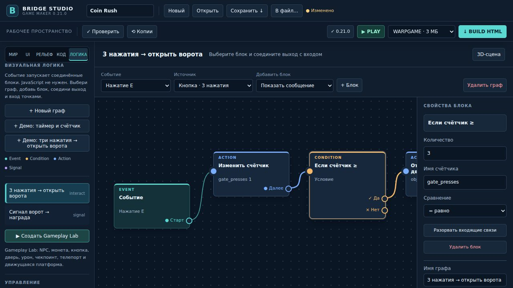
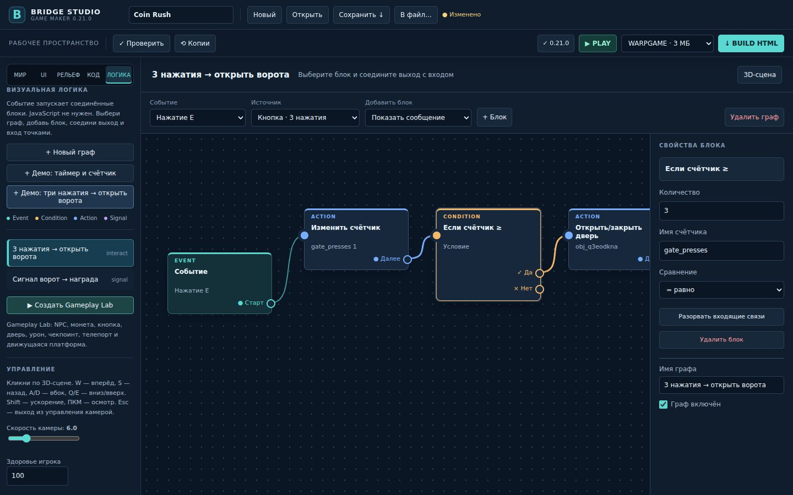

# Bridge Studio — screenshots & hands-on preview

**Bridge Studio is frozen and accepting community-maintained forks.** [Source](../README.md) · [MIT license](../LICENSE) · [Contribution guide](../CONTRIBUTING.md)

> Screenshot evidence below was produced by automated Chromium/WebGL regression tests and represents **actual editor renderings**, not AI concept art. Some older screenshots predate the latest signed v0.22.2. There is no claim of hardware GPU or Windows installer certification.

## Editor workspace



The editor has a 3D viewport, panels and scene manipulation tools. For a precise technical breakdown see [ARCHITECTURE.md](../ARCHITECTURE.md) and [COMMUNITY_HANDOFF.md](../COMMUNITY_HANDOFF.md).

## Visual logic graph



The node editor models event-driven gameplay, signals, timers, counters and action components. Source: [D-01 browser test screenshot notes](design-d01/README.md).

## Responsive workspaces

| 1280 × 720 | 1440 × 900 |
| --- | --- |
|  |  |

## Try the existing editor build

**[Open experimental browser editor (v0.22.2)](https://jonhspoky2.github.io/bridge-studio-updates/updates/v0.22.2/studio.html)**

This link points directly to the existing public, previously published signed-update HTML, not to a newly distributed executable or patch. In supported browsers, the editor UI can load using WebGL/Three.js. **Browser-hosted operation is experimental**: integrations that rely on the local Windows host, permissions, update installation, local file access or environment-specific auth may not work there. No real Windows/GPU acceptance testing is implied by a successful page load.

To build a local editor HTML from the current public source instead:

```sh
git clone https://github.com/jonhspoky2/bridge-studio-updates.git
cd bridge-studio-updates
python3 tools/build_studio.py --output studio.html
```

Open through a suitable local HTTP server for browser testing, and see [TESTING.md](../TESTING.md) for how headless CI supplies its dependencies. Building an editor HTML **does not produce a Windows installer**.

## What the project can and cannot do

| Area | Current state |
| --- | --- |
| Terrain sculpt/paint | Available |
| Build/Play tools | Available |
| Game export to standalone HTML | Available |
| WARPGAME size enforcement | 3,000,000 bytes exported HTML |
| Visual scripting, quests, counters | Initial implementations available |
| GLB mesh import | Basic importer available |
| glTF skeletal animations / skinning | **Not yet supported** in custom loader |
| High-quality original 3D asset library | **Not provided** |
| Independently verified Windows installers | **Not provided** by a source build |
| Latest official signed release | **v0.22.2**; community work is not automatically released |

## Community contribution opportunities

This project needs help with glTF animation support, original GLB scene assets, Play/HTML parity, Windows GPU visual QA and a more modular editor architecture. [Join the maintainer conversation](https://github.com/jonhspoky2/bridge-studio-updates/issues/30), or fork and contribute independently.

Copyright © 2026 **jonhspoky2**. Project source: [MIT](../LICENSE). Third-party code, assets and trademarks retain their original rights.
