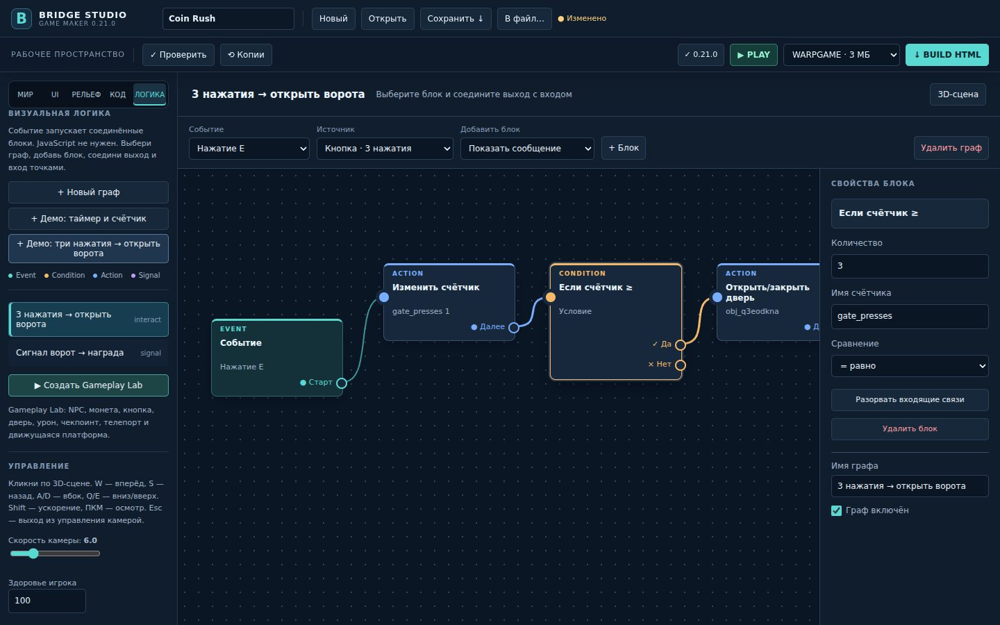

# Design D-01 — результаты проверки

База сравнения — main 330302e73f7387015629b2c753bb5ab2d0943343. Изображения получены из двух HTML-сборок реальным Chromium 149 с Three.js r128 и программным WebGL SwiftShader. Исходная сцена и граф «три нажатия → открыть ворота» одинаковы. JPEG сохраняется самим браузером. Генерация изображений не использовалась.

## До и после

| Размер | До | После |
|---|---|---|
| Оболочка 1440×900 | [До](before-shell.jpg) | [После](after-shell.jpg) |
| Граф 1280×720 | [До](before-logic-1280.jpg) | [После](after-logic-1280.jpg) |
| Граф 1440×900 | [До](before-logic-1440.jpg) | [После](after-logic-1440.jpg) |
| Граф 1920×1080 | [До](before-logic-1920.jpg) | [После](after-logic-1920.jpg) |



## Проверки

- Сборка tools/build_studio.py и синтаксис src/studio.js прошли.
- Девять существующих Node-серий прошли — terrain-core, terrain-walk, terrain-slope, gameplay-v020, gameplay-v021, terrain-sculpt, terrain-paint, terrain-paint-performance и terrain-sculpt-performance.
- Четыре существующих браузерных сценария прошли — terrain-browser, gameplay-v020-browser, gameplay-v021-browser и terrain-sculpt-browser.
- Новый tests/design-d01.cjs прошёл выбор объекта, редактирование имени и X-позиции, создание графа, изменение текста блока, создание условия, соединение портов и перетаскивание узла настоящими событиями мыши.
- Проверены привязка линии к порту, категория Signal, зависимые поля события, пустое состояние, видимый клавиатурный фокус, границы панелей и Toolbar при трёх заданных размерах.
- Скачанный .rwscene сравнен с документом сцены. После Play/Stop документ совпал. Экспортированный HTML отрисовался и персонаж встал на поверхность.
- На 1280×720 граф прокручивается внутри рабочей области. Боковые панели прокручиваются отдельно, глобального горизонтального переполнения нет.

## Воспроизведение

Установить Playwright и Three.js r128. Выполнить из корня репозитория:

```sh
python3 tools/build_studio.py --output /tmp/bridge-design.html
node tests/design-d01.cjs
```

Для собственного Chromium можно задать CHROMIUM_BIN, для файла библиотеки — THREE_R128. Локально существующие браузерные тесты запущены с Chromium 149 через временную подстановку executablePath; файлы существующих тестов не менялись.

## Ограничения

Реальный Windows Bridge.exe и аппаратный GPU в этой среде не запускались. Разрешения ниже 1280×720 и пользовательский масштаб 125–200% не входят в пройденную матрицу. Это UI-изменение исходников; действующий подписанный канал остаётся v0.21.0.
